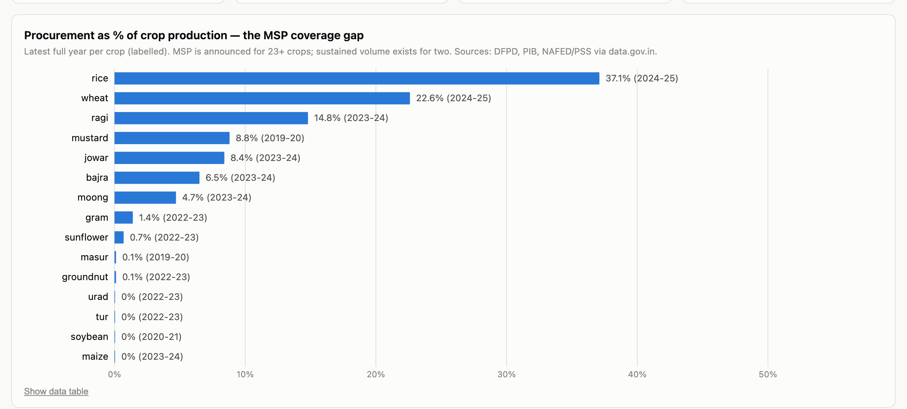
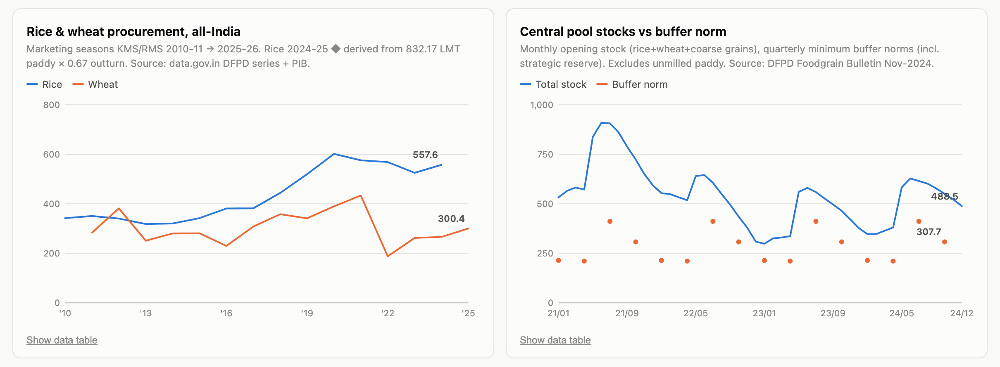
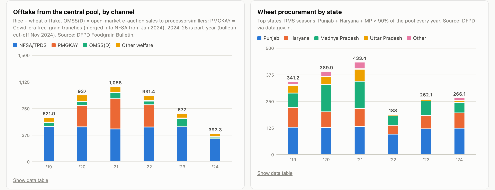
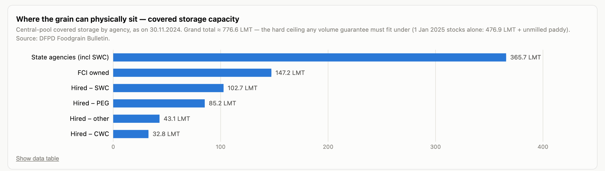

# FCI Warehouse: MSP vs MSV

Research and data project on India's foodgrain procurement system. It asks whether a
**Minimum Support Volume (MSV)** guarantee (government committing to buy a minimum
*quantity* of each crop) could extend effective price support beyond rice and wheat, the
only crops where the **Minimum Support Price (MSP)** works in practice. It produces cited
Markdown reports (`report/`), 49 source-tagged CSVs with a provenance manifest (`data/`),
a self-contained HTML dashboard (`dashboard/`), and a small Python package of
deterministic scenario / unit-economics models (`fci_msv/`) that regenerate some of the
CSVs and the figures quoted in the reports.

> Status: active research snapshot. Figures come from official Indian sources (DFPD,
> FCI, CACP, APEDA/DGCI&S, MoSPI, PIB) and cited analyses; nothing is interpolated by the
> collector. Policy research only, not investment or business advice.

> New here? See [How to use this repo with AI](HOW_TO_USE_WITH_AI.md) and the
> [GLOSSARY](GLOSSARY.md) of every abbreviation used in the reports.

[](https://colab.research.google.com/github/herrrickshaw/FCI-warehouse-MSPvsMSV/blob/main/notebooks/fci_msp_msv_analysis.ipynb)

## What it does
- Documents FCI procurement trends (10-15 yrs): rice/wheat volumes, state concentration, central pool stocks vs buffer norms, economic cost vs MSP, food subsidy burden.
- Explains why MSP works for rice and wheat only, and reviews the existing extensions (PM-AASHA PSS/PDPS/PPSS, NAFED pulses and oilseeds, CCI cotton).
- Builds the MSV case: volume guarantee design, fiscal cost, storage/disposal constraints, WTO AMS limits, US CCC / EU intervention analogues; plus a Haryana case study and the ethanol-offtake precedent.
- Rebuilds `data/trade_price_parity.csv` (67 rows, DGCI&S/APEDA FY24-FY26) with unit values, implied FX and the gap to MSP, via `fci_msv.trade_parity`.
- Runs deterministic scenario models: rice-bran oil (RBO) import substitution, biodiesel blending from acid oil, OMSS wheat/paddy milling unit economics, holding (storage) economics from WPI, and a Real Farm Income Index.
- Renders an interactive procurement vs storage vs disposal dashboard (`dashboard/index.html`, light/dark, table views).

## Quick start
```bash
git clone https://github.com/herrrickshaw/FCI-warehouse-MSPvsMSV.git
cd FCI-warehouse-MSPvsMSV
python -m venv .venv && source .venv/bin/activate
pip install -e ".[dev]"
python3 data/holding_economics.py        # WPI CAGR vs carrying cost -> data/holding_*.csv
```
The other entry points are `data/build_trade_parity.py`, `data/consolidated_savings_by_crop.py`,
`data/rbo_savings_scenarios.py`, `data/biodiesel_blending_scenarios.py`,
`data/omss_processing_model.py` and `data/rfii_monitor.py`. Each prints its table and, where
applicable, rewrites its CSV in `data/`. The dashboard needs no build: open
`dashboard/index.html` (append `?theme=dark` to force dark mode).

## How it works

| Stage | Module | Output |
|---|---|---|
| Pinned source rows (APEDA/DGCI&S captures, 2026-07-23) -> unit values, implied FX, parity gap | `fci_msv/trade_parity.py` | `data/trade_price_parity.csv` |
| Import price x substitutable volume -> Rs crore saving per product | `fci_msv/consolidated_savings.py` | `data/consolidated_savings_by_crop.csv` + console table |
| WPI monthly index -> CAGR vs carry cost, harvest-buy horizon returns, post-crash episodes | `fci_msv/holding.py` | `data/holding_economics_summary.csv`, `holding_horizon_returns.csv`, `holding_episodes.csv` |
| Bran -> RBO -> import displaced / DORB feed, by processed share | `fci_msv/rbo.py` | console table |
| Bran -> acid oil -> biodiesel -> blend %, by bran utilisation | `fci_msv/biodiesel.py` | console table |
| OMSS / mandi grain -> milling outturn -> EBITDA per qtl and 300 TPD mill ROCE | `fci_msv/omss.py` | console table |
| Nominal farm income / CPI-AL -> RFII (base 2016-17 = 100, target 200) | `fci_msv/rfii.py` | console table |

Design notes:
- Every model module is **load -> compute -> render**: constants carry their unit in the name
  (`_LMT`, `_RS_PER_KG`, `_RS_QTL`) and their source in a comment; computation functions take
  data in and return dicts/frames; `render()` returns the console lines; `main()` is the only
  place that prints or writes. Output paths are parameters defaulting to `data/` via
  `fci_msv/paths.py` (no `os.chdir`).
- `data/*.py` are thin shims kept so the commands cited in the reports and `data/MANIFEST.md`
  still work.
- The models are deterministic and offline: inputs are pinned in source or read from tracked
  CSVs; nothing fetches live data. `fci_msv/units.py` holds the LMT / crore conversions.
- The dashboard reads `dashboard/dashboard_data.json`; the Colab notebook reads the CSVs
  straight from GitHub raw URLs.

## Dashboard highlights

**The one-picture argument**: MSP is announced for 23+ crops, sustained procurement volume exists for two.



**Procurement trend and stocks vs buffer norms**: record buying, stocks pulling away from need.



**Where the grain goes and who supplies it**: offtake by channel (incl. OMSS sales to processors) and Punjab-heavy wheat concentration.



**The physical ceiling**: covered storage capacity, the hard constraint on any volume guarantee.



Full-page views: [light](dashboard/screenshots/full_light.png) / [dark](dashboard/screenshots/full_dark.png).

## Repository layout
| Path | Purpose |
|---|---|
| `report/` | 45 cited Markdown reports: main MSP-vs-MSV evaluation, Haryana case study, trade parity, holding economics, RBO/biodiesel/OMSS models, executive summary |
| `report/pricing-msp-msv-published.html` | Published essay "The Price of Grain" (price ladder, farmer coverage, trade parity, MSP+MSV ratio framework) |
| `fci_msv/` | Python package: the seven scenario / unit-economics models (pure functions + `main()`) |
| `data/*.py` | Thin entry points (`python3 data/<script>.py`) delegating to `fci_msv` |
| `data/*.csv`, `data/MANIFEST.md` | 49 tracked CSVs; the manifest records source URL, vintage and gaps per file. Five CSVs are generated by the models (see table above), the rest are hand-collected |
| `data/raw/`, `data/raw_trade/` | Raw captures: CACP MSP JSON, CWC tariff, MSP statement, WPI xls, APEDA/TradeStat JSON |
| `dashboard/` | Self-contained HTML dashboard + `dashboard_data.json` + screenshots |
| `notebooks/` | Colab notebook reproducing the charts from the CSVs |
| `pitch/` | Grain-value-loop pitch deck and business-model workbooks |
| `tests/` | pytest suite with golden console outputs |
| `graphify-out/` | Generated knowledge graph of the repo (not source) |

## Data sources
| Source | What is taken | Access route | Licence / caveat |
|---|---|---|---|
| DFPD Monthly Foodgrain Bulletin | procurement, offtake, stocks vs norms | bulletin PDFs | official; per-file notes in `data/MANIFEST.md` |
| FCI (fci.gov.in) | storage capacity, movement, economic cost | published tables | official |
| CACP (https://cacp.da.gov.in/Home/MSP) | MSP series 2010-11..2026-27 | `data/raw/cacp_msp.json` | official |
| OEA WPI (eaindustry.nic.in) | monthly commodity WPI, base 2011-12 | `data/raw/wpi_monthly_1112.xls` | official |
| APEDA AgriExchange (agriexchange.apeda.gov.in) | DGCI&S export/import statements, HS-8 pulses, principal commodities | JSON captures in `data/raw_trade/` (2026-07-23) | official; FY2025-26 provisional |
| DGCI&S TradeStat (tradestat.commerce.gov.in) | edible-oil HS-code imports | `data/raw_trade/tradestat_oils_raw.json` | official |
| CWC (cewacor.nic.in) | commodity-wise storage tariff FY2024-25 | `data/raw/cwc_commodity_tariff_2425.md` | official |
| MoSPI CPIALRL, NSSO SAS, NABARD NAFIS | CPI-AL deflator, farm household income | values pinned in `fci_msv/rfii.py` | official surveys; last measured income point 2021-22 |
| UPAg, PIB, CACP, Economic Survey, CAG, ICRIER, NITI Aayog, academic papers | context figures in reports | cited inline | see each report |

## Configuration
No environment variables or secrets. Model inputs are named constants at the top of each
`fci_msv/*.py` module (with source comments); output paths default to `data/` and can be
passed to `main()` / `write_csv()` / `write_outputs()`.

## Testing
```bash
ruff check .
pytest -q        # 35 tests: unit tests on the pure functions, golden stdout, byte-identical CSV rebuilds
```

## Limitations and known issues
- The models are illustrative, not forecasts; several inputs are flagged in source as
  assumptions (sugar value Rs 3,500/qtl, millet MSP proxied by jowar, groundnut in-shell vs kernel basis).
- `data/MANIFEST.md` mentions a `build_csvs.py` rebuild script for the hand-collected CSVs; it is not in the repo.
- Trade rows are a one-off capture (2026-07-23); re-running `build_trade_parity.py` does not refresh them.
- Running the model scripts rewrites the generated CSVs in `data/`; `git diff` should stay empty unless inputs changed.
- Gaps noted in the manifest: refined soy/sun oil import lines not pulled, pulses-export basket not HS-split, niryat.gov.in geo-fenced.

## Licence
No licence file yet; all rights reserved.
